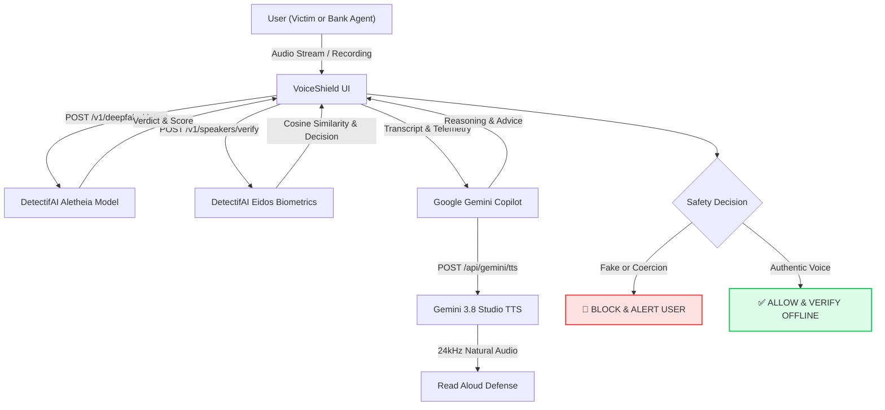

# VoiceShield (aka ConsentGuard) — Official 5-Slide Pitch Deck
**Event:** UNCLONE AI Hackathon (B.M.S. College of Engineering × DetectifAI)  
**Track:** Track 03 — UNCLONE AGENTS  
**Project:** VoiceShield (ConsentGuard) — Voice-First AI Safety Copilot Intercepting Coercive Voice Calls & AI Impersonation  
**Authors:** Team VoiceShield  

---

## Slide 1: Problem
### Voice-Call Scams Targeting Women & Families in India
* **The Reality**: AI voice-cloning models replicate loved ones and authority figures with nuanced regional accents in under 3 seconds, turning ordinary phone calls into psychological coercion weapons.
* **Documented Indian Cases**:
  1. **Hyderabad Nephew Scam (Jan 2026)**: A 59-year-old woman received a call from an AI clone of her nephew in a Punjabi accent claiming an emergency road accident. She transferred ₹1.4 lakh via QR code before discovering the voice was cloned.
  2. **Indore Police Cousin Scam (Jan 2026)**: A schoolteacher ("Smita") received an urgent call from her UP Police cousin's cloned voice asking for ₹97,500 for a friend's ICU angioplasty. MP Police confirmed it as the state's first confirmed AI voice fraud.
  3. **Bengaluru Fake CBI "Digital Arrest" (Apr 2024)**: A 29-year-old woman lawyer was held in a 2-day virtual hostage Skype call over a fake FedEx narcotics parcel. Scamsters extorted ₹10.79 lakh and coerced her on camera under the guise of a "narcotics inspection."
  4. **Bengaluru Bogus "Medical Exam" Sextortion (Jul 2025)**: Two women were kept on a 9-hour WhatsApp video call under false arrest, extorted for ₹58,447, and forced to undress on camera for a bogus online medical exam to identify "moles and tattoos."
* **Scale & Urgency**: 83% of Indian AI-voice victims lose money; 47% know someone hit. 69% of citizens cannot tell an AI clone from a genuine human voice.
* **The Critical Gap**: Standard spam blockers (like Truecaller) only check caller ID numbers, leaving victims completely blind to deepfake audio and psychological extortion.

---

## Slide 2: Solution
### VoiceShield (ConsentGuard): A Voice-First Safety Copilot
* **Active Interception**: VoiceShield runs as a vigilant co-pilot during suspicious calls (or call-center inquiries), listening for synthetic voices, biometric mismatches, and coercive demands before victims comply.
* **Dual-Layer Biometric & Authenticity Shield**:
  1. **Audio Authenticity Check (DetectifAI Aletheia)**: Scans audio frames for synthetic neural speech artifacts.
  2. **Speaker Verification Check (DetectifAI Eidos)**: Compares acoustics against enrolled voiceprints of trusted contacts (parents, children, relatives, corporate leads).
  * *Crucial Principle: "A cloned voice can clear a voiceprint. It still has to pass the authenticity check."*
* **Gemini Safety Reasoning**: Google Gemini analyzes transcript semantics in real time to spot digital arrest threats, medical blackmail, and emergency QR extortion.
* **Studio-Quality Protective Speech**: VoiceShield uses Google Gemini Studio TTS (`gemini-3.8-flash-tts`) to deliver calm, firm, de-escalating counter-response scripts aloud to guide the user off the call safely.

---

## Slide 3: DetectifAI Integration & Architecture
### Production API Integration with Aletheia & Eidos Models

* **Production API Endpoints Utilized**:
  * `POST https://platform.detectif.ai/v1/deepfake/detect`: Deepfake verdict (`fake`/`real`/`not_sure`), synthetic score (0–1), and sensitivity threshold (~0.62 default).
  * `POST https://platform.detectif.ai/v1/speakers/verify`: Speaker cosine similarity, threshold comparison, and biometric decision (`match`/`no_match`).
  * `POST https://platform.detectif.ai/v1/speakers/enroll`: Multi-sample centroid voiceprint registration.
* **Forensic Traceability**: All evaluations log `request_id`, model version, latency, credit consumption, and exact margin numbers in an interactive Developer Telemetry Drawer.

---

## Slide 4: Impact & Real-World Benefits
### Shielding Vulnerable Citizens, Women, and Enterprise Banking
* **Breaks the Scam Loop**: Fraudsters rely on emotional panic ("Your nephew is dying in ICU") or authority paralysis ("CBI is sending police to your house"). An instant, factual alert breaks the cognitive compliance loop immediately.
* **Combating Sextortion & Degradation**: Specific policies (POL-02) instantly detect and block online medical exam coercion and camera blackmail, protecting women's bodily autonomy and dignity.
* **Explainability Builds Trust**: VoiceShield does not make vague assertions; it displays transparent synthetic percentages, voice continuity charts, and clear reasoning.
* **Bank IVR & Customer Service Pilot**: Deployable on consumer smartphones or embedded directly into banking voice assistants to pause emergency payouts whenever a synthetic voice is flagged.

---

## Slide 5: Scale, Privacy & Future Roadmap
### From Hackathon Prototype to National Defense Shield
* **Day-1 MVP**: End-to-end working pipeline (microphone listening, audio upload, DetectifAI deepfake detection, Gemini reasoning, and natural studio TTS).
* **Day-2 12-Hour Sprint**:
  * Family Voice Vault: Multi-sample biometric enrollment for trusted contacts.
  * Adaptive Noise Filtering: Spectral noise suppression for Indian telecommunication band-pass constraints (8kHz GSM).
  * Hindi & Regional Dialect Localization: VoiceShield advice delivered in Hindi, Kannada, Telugu, and Punjabi.
* **Privacy by Design (DPDP Act 2023 Compliance)**:
  * Audio recordings are analyzed transiently in volatile memory and never permanently stored.
  * Zero-knowledge biometrics: only numerical acoustic embeddings are compared.
* **MCP Agent Ecosystem**: DetectifAI Model Context Protocol allows VoiceShield to integrate into Android dialers, Truecaller, WhatsApp call listeners, and telecom carrier networks.
